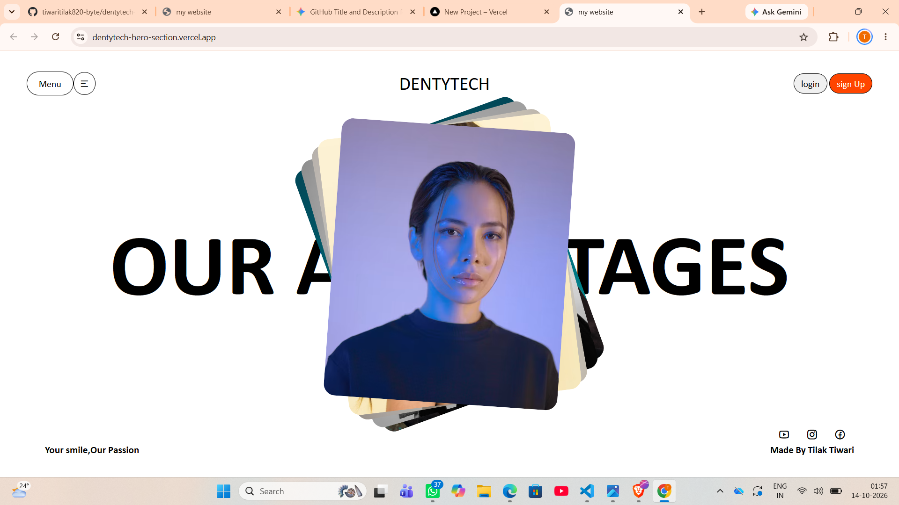

# Dentytech Landing Page

A sleek, stylish frontend landing page concept designed for **Dentytech**, highlighting layered image styling and minimal interface components.

## 🔗 Live Demo : 

## 📸 Preview




## ✨ Features

- **Modern Hero Section:** Bold typography layered behind stacked, rotated visual cards.
- **Navigation Bar:** Clean layout with quick action buttons ("Login", "Sign Up") and custom pill-shaped tags.
- **Icon Integration:** Utilizes Remix Icon CDN for responsive UI elements and social icons.
- **Pure CSS Layout:** Built completely without external JavaScript or CSS frameworks.

## 🛠️ Built With

- **HTML5**
- **CSS3** (Flexbox, Absolute Positioning, CSS Transforms)
- **Remix Icon**

## 🚀 Getting Started

1. Clone or download the repository:
   ```bash
   git clone [https://github.com/tiwaritilak820-byte/dentytech-hero-section.git](https://github.com/tiwaritilak820-byte/dentytech-hero-section.git)
